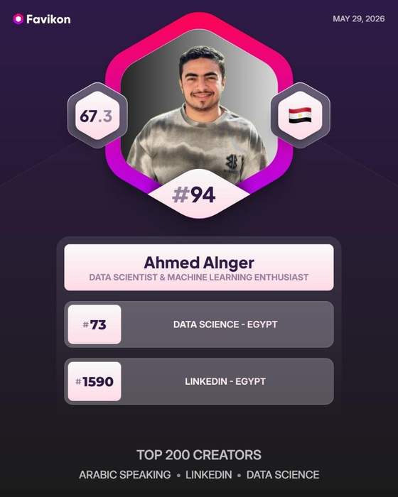
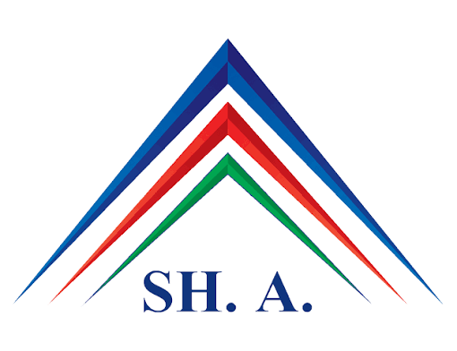

### 🏆 Top Data Creator in Egypt &amp; Arabic Speaking Worldwide

**Data Scientist · Machine Learning Specialist · Data Visualization (Power BI &amp; Excel) · Python &amp; SQL for Data Science**

  
  
  
  

---

## 👨‍💻 About Me

I'm a **Full-Stack AI Engineer** who loves turning raw data into decisions and models into real products. I work across the whole pipeline: **data analysis → machine learning → deep learning → LLMs → deployment**.

- 🎓 Final-year **Information Systems** student at **Shorouk Academy**, graduating in **2027**
- 🧠 Specializing in **Machine Learning**, with a focus on end-to-end ML pipelines, Deep Learning, Explainable AI (XAI), Privacy-Preserving Federated Learning, and LLM integration
- 📊 Building interactive dashboards and data stories with **Power BI** and **Excel**
- 🚀 Shipping models as working tools with **FastAPI**, **Streamlit**, and **ONNX Runtime**
- 🔬 Researcher at heart, and a big fan of **space and astronomy** 🌌
- 🎙️ Creating Data Science &amp; AI content and breaking down complex ideas for the Arab tech community

 

## 🛠️ Tech Stack

### 📊 Data Analysis (my core 4)

  
  
  
  

### 🤖 Machine Learning

  
  
  
  
  
  
  
  
  
  

### 🧬 Deep Learning

  
  
  
  
  

### 💬 Large Language Models (LLMs)

  
  
  
  
  

### 🚀 Deployment &amp; Productization

  
  
  

 

## 🏅 Recognition

| Ranking (Favikon, May 2026) | Position |
| :-- | :--: |
| 🌍 Top Creators · Arabic Speaking · LinkedIn · Data Science | **#94** |
| 🇪🇬 Data Science · Egypt | **#73** |
| 💼 LinkedIn · Egypt | **#1590** |

 

## 🎓 Education

<table>
  <tr>
    <td width="130" align="center"></td>
    <td>
      <b>Bachelor's in Information Systems</b> 
      Shorouk Academy · 4th year 
      Expected graduation: <b>2027</b>
    </td>
  </tr>
</table>

 

## 🔭 Interests

- 🧪 Research in AI and Machine Learning
- 🌌 Space and astronomy
- 📚 Teaching and simplifying Data Science for the Arab community

 

## 📈 GitHub Stats

 

## 🤝 Let's Connect

